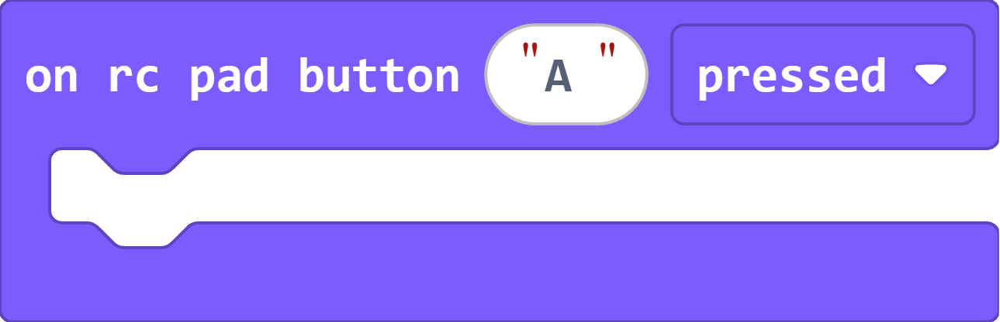
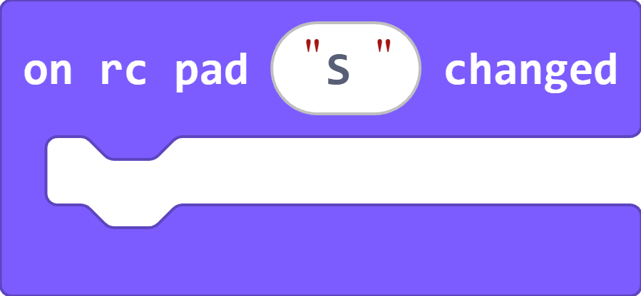
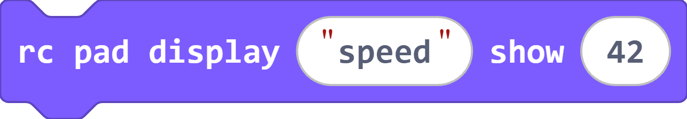
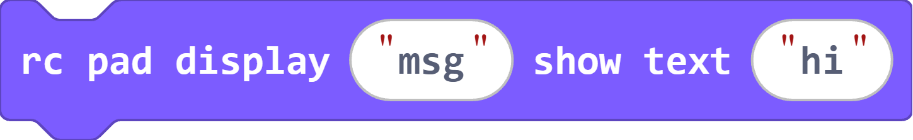
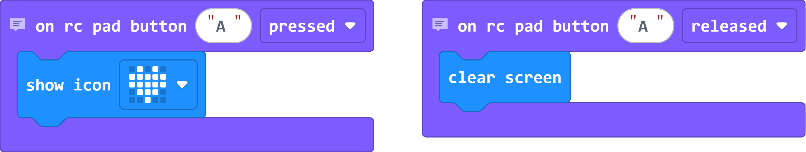
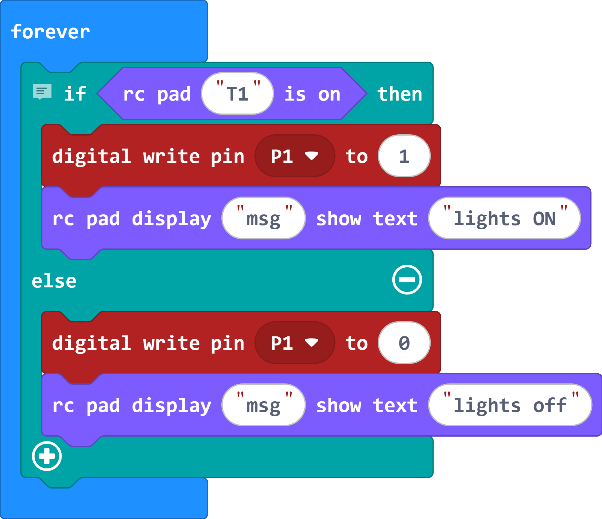
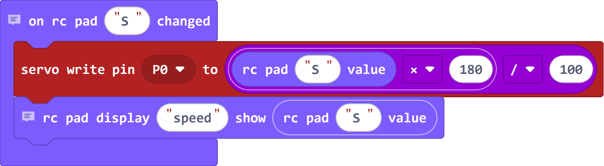
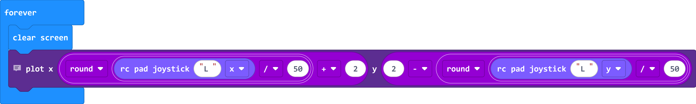
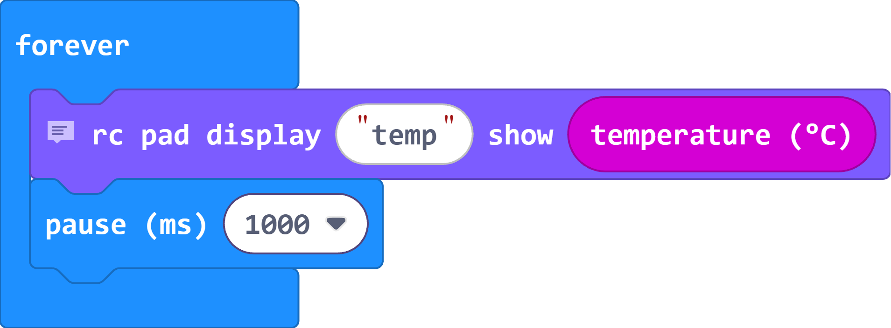

# micro:bit RC Pad

A customizable Bluetooth gamepad for the BBC micro:bit, inspired by
[hoverbit-ble](https://github.com/JakobST1n/hoverbit-ble) and
[microbit-gamepad](https://github.com/JakobST1n/microbit-gamepad).

It has two parts:

* **The web app** (`app/`): runs in Chrome/Edge on a phone, tablet or PC. **[Open the app](https://ikaros-ch.github.io/microbit-rc/)**
* **Android app**: `rc-pad.apk` on the [latest release](https://github.com/ikaros-ch/microbit-rc/releases/latest) opens the same app full screen. It needs Chrome installed, see [Android app](#android-app).
* **The MakeCode extension** (this repo's root): adds an **RC Pad** block category to MakeCode.

## Features

| Widget | Sends to micro:bit | Bind keyboard / controller |
|---|---|---|
| **Button** | 1 while held, 0 when released | any keys and pad buttons/axes |
| **Toggle switch** | flips between 0 and 1 on each press | any keys and pad buttons |
| **Slider** (linear pot) | 0–100, stays where you leave it | keys/pad buttons move it up or down, analog triggers move it in proportion |
| **Single-axis stick** (drone-style gimbal) | -100 to 100. Springs back to center, or turn spring-back off so it holds position like a throttle stick | +/− bindings: pad sticks are analog, keys move it fully (or ramp it when spring-back is off) |
| **Joystick** (thumbstick) | x, y from -100 to 100, springs back to the center | separate up/down/left/right bindings, pad sticks are analog |
| **Display** | shows data the micro:bit sends as text, bar, graph or lamp | – |

* **Edit mode**: drag widgets anywhere and resize them with the corner handle. Tap one to set its ID, label, color, bindings and display options.
* **Bindings**: press **+ Bind**, then press a key, a controller button or move a stick. You can bind as many inputs to one widget as you like, and touch always works too.
* **Controllers** use the browser Gamepad API (Xbox, PlayStation and most USB/Bluetooth pads). Plug one in and press any button so the browser detects it.
* **Greek / English**: the app follows your browser language, or pick **EN / ΕΛ** in the toolbar. The MakeCode blocks are translated too, so switch MakeCode to Ελληνικά. Widget labels can be Greek; texts sent to the micro:bit, IDs and channel names must use English letters (see [Notes](#notes)).
* **⟳ Rotate**: turns the whole app 90° per press, so you can hold a phone sideways while the browser stays in portrait (or the other way round). Touch, dragging and resizing work at every angle, and the app remembers your choice.
* **Layouts** are saved in the browser. Use **Export** / **Import** to back them up or share them as JSON files.

## MakeCode extension

1. Open [makecode.microbit.org](https://makecode.microbit.org) and create a new project.
2. Go to **Extensions** and paste `https://github.com/ikaros-ch/microbit-rc`.
3. Accept that the extension removes `radio`, because Bluetooth and radio can't run together.

### Blocks

| Block | What it does |
|---|---|
| [](docs/on-button.md) | runs when a button widget goes down or up |
| [](docs/on-change.md) | runs when any widget with that ID changes |
| [](docs/is-on.md) | true while a button is held or a toggle is on |
| [](docs/value.md) | slider 0–100, single-axis stick -100..100 (0/1 for buttons and toggles) |
| [](docs/joystick.md) | -100..100, right and up are positive |
| [](docs/show.md) | shows a number on every display widget set to that channel |
| [](docs/show-text.md) | shows text the same way |

The micro:bit sends display values at most every 100 ms and resends all of them every 2 s, so you can call `show` in a fast `forever` loop.

A demo `.hex` that matches the app's default layout is attached to each [release](https://github.com/ikaros-ch/microbit-rc/releases/latest). It is built from [test.ts](test.ts).

### Notes
* **Bluetooth pairing:** in MakeCode open ⚙ → **Project Settings** and select **No Pairing Required**, then download. The extension asks for it, but MakeCode may still show *JustWorks*. With JustWorks the app connects, but the micro:bit ignores every button.
* **Upgrading from v1:** v2 renamed the blocks' code from `gamepad.` to `rcPad.` (and `GamepadButtonEvent`/`GamepadAxis` to `rcPad.ButtonEvent`/`rcPad.Axis`), so it doesn't clash with the `blehid` extension. Block projects keep working; fix JavaScript projects by renaming.
* The extension uses the Bluetooth UART receive handler, so don't add your own `on bluetooth data received` block.
* IDs and channel names can only use English letters, digits and `_`, with at most 8 characters.
* Texts can be any length, but only English letters, digits and symbols: MakeCode for micro:bit can't store Greek or other non-English letters in text. Long texts are split into 20-byte Bluetooth packets, which the app joins back together.

## Examples

Each example uses the widget IDs of the app's default layout.

### Heart on a button

Show a heart while button **A** is held.



<details><summary>Show code</summary>

```blocks
// Show a heart while button A is held
rcPad.onButton("A", rcPad.ButtonEvent.Pressed, function () {
    basic.showIcon(IconNames.Heart)
})
// Clear the screen when A is released
rcPad.onButton("A", rcPad.ButtonEvent.Released, function () {
    basic.clearScreen()
})
```

</details>

### Light switch

Toggle **T1** turns a light (an LED with a resistor) on pin P1 on and off, and shows the state on the app's **msg** display.



<details><summary>Show code</summary>

```blocks
basic.forever(function () {
    // Toggle T1 switches a light on pin P1 and tells the app
    if (rcPad.isOn("T1")) {
        pins.digitalWritePin(DigitalPin.P1, 1)
        rcPad.showText("msg", "lights ON")
    } else {
        pins.digitalWritePin(DigitalPin.P1, 0)
        rcPad.showText("msg", "lights off")
    }
})
```

</details>

### Servo on a slider

Slider **S** turns a servo on pin P0, and the **speed** display shows its position.



<details><summary>Show code</summary>

```blocks
// Slider S (0-100) turns a servo on P0 (0-180 degrees)
rcPad.onChange("S", function () {
    pins.servoWritePin(AnalogPin.P0, rcPad.value("S") * 180 / 100)
    // Show the position on the app's "speed" display
    rcPad.show("speed", rcPad.value("S"))
})
```

</details>

### Joystick dot

Joystick **L** moves one LED around the screen.



<details><summary>Show code</summary>

```blocks
basic.forever(function () {
    basic.clearScreen()
    // Joystick L moves one LED: -100..100 maps to columns and rows 0..4
    led.plot(Math.round(rcPad.joystick("L", rcPad.Axis.X) / 50) + 2, 2 - Math.round(rcPad.joystick("L", rcPad.Axis.Y) / 50))
})
```

</details>

### Temperature display

Send the micro:bit temperature to the app's **temp** display once a second.



<details><summary>Show code</summary>

```blocks
basic.forever(function () {
    // Send the temperature to the app's "temp" display
    rcPad.show("temp", input.temperature())
    basic.pause(1000)
})
```

</details>

## Android app

The APK is a [Trusted Web Activity](https://developer.chrome.com/docs/android/trusted-web-activity): it opens the site full screen through Chrome. A plain Android WebView can't be used because it doesn't support Web Bluetooth.

* Install `rc-pad.apk` from the release page. You may need to allow installs from unknown sources.
* The app always loads the live site, so app updates arrive without a new APK.
* A thin URL bar may show at the top. Hiding it needs a `/.well-known/assetlinks.json` file on `ikaros-ch.github.io` with the APK's signing fingerprint.
* `android/` holds the project. CI builds it on every change and attaches it to each release.

## Protocol

Messages are UTF-8 text lines, ending in `\n`, over the Nordic UART service. A line can span several 20-byte packets, so you can use them from any firmware.

| Direction | Line | Meaning |
|---|---|---|
| app → micro:bit | `B<id>=0\|1` | button |
| app → micro:bit | `T<id>=0\|1` | toggle |
| app → micro:bit | `S<id>=0..100` | slider |
| app → micro:bit | `A<id>=-100..100` | single-axis stick |
| app → micro:bit | `J<id>=<x>,<y>` | joystick, -100..100 |
| micro:bit → app | `D<channel>=<value>` | display data |

The app only sends a widget's value when it changes, and it sends every value again right after connecting.

## Develop

The app has no build step. Serve `app/` with any static server and open it on `localhost`, because Web Bluetooth needs a secure context:

```sh
npx http-server app      # or: python -m http.server -d app
node app/core.test.mjs   # input logic self-check
npx makecode build       # compile the extension + demo
```

Pushing to `main` deploys `app/` to GitHub Pages.

## Learn more

* **[Tutorial: Drive your micro:bit with your phone](https://makecode.microbit.org/#tutorial:https://github.com/ikaros-ch/microbit-rc/rc-pad-tutorial)**: a step-by-step guide inside MakeCode (also in Greek)
* [Bluetooth pairing on the micro:bit](https://makecode.microbit.org/reference/bluetooth/bluetooth-pairing)
* [MakeCode Bluetooth UART reference](https://makecode.microbit.org/reference/bluetooth/start-uart-service)
* [MakeCode events and handlers](https://makecode.microbit.org/blocks/on-start)
* [Gamepad API (for controllers in the app)](https://developer.mozilla.org/en-US/docs/Web/API/Gamepad_API/Using_the_Gamepad_API)

## License

MIT

## Supported targets

* for PXT/microbit
